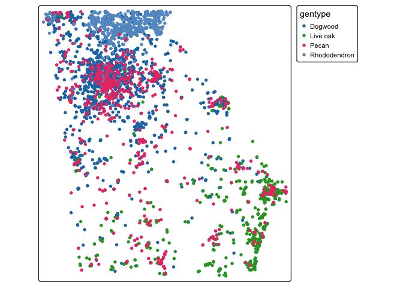
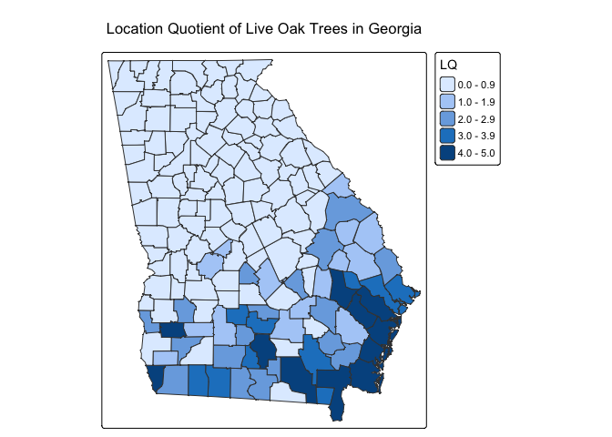
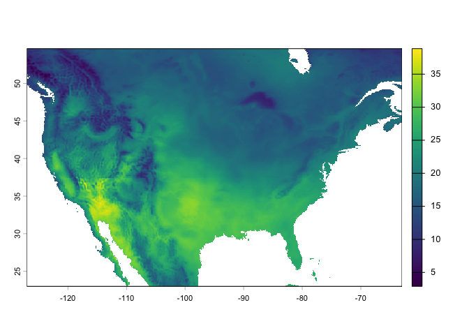
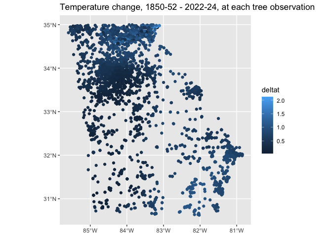

# Geog 4/6300: Lab 2


# Spatial statistics with vector and raster data

**Overview:**

In this lab, you’ll work with point, polygon, and raster data to
investigate the distribution and environmental characteristics of trees
in Georgia.

You’ll begin with observations of two tree species collected through the
iNaturalist citizen-science platform. First, you’ll use these
observations to calculate the number of trees of each species found in
Georgia’s counties. You’ll then use these counts to calculate a
**location quotient (LQ)**, a measure that compares the prevalence of a
species in each county with its prevalence across the state as a whole.

In the second part of the lab, you’ll use temperature data from the ERA5
climate reanalysis to investigate the temperatures associated with
observations of the two tree species. You’ll extract temperature values
from a raster for each tree observation and then calculate descriptive
statistics for each species.

The ERA5 data we are using were obtained through the Google Earth Engine
platform. More information is available at
<https://github.com/communitymaplab/era5_1950-69_2014-2024>.

For this lab to be marked complete, the following criteria must be met:

- Your responses should show your ability to load and manipulate point
  and polygon vector data. (Tasks 1–3)
- Your responses should show your ability to calculate counts and create
  new variables from spatial data. (Tasks 2–4)
- Your responses should show your understanding of the location quotient
  as a measure of spatial concentration. (Tasks 4–5)
- Your responses should show your ability to load raster data and
  extract raster values at point locations. (Tasks 6–8)
- Your responses should show your ability to manipulate data frames and
  calculate summary statistics. (Tasks 9–10)
- Your responses should demonstrate your ability to describe statistical
  and spatial patterns in geographic data.

Before you get started, you’ll need to load the following packages:
`tidyverse`, `terra`, `sf`, and `tmap`. You may also want to use `knitr`
for displaying tables.

``` r
# Load packages here.

library(tidyverse)
```

    ── Attaching core tidyverse packages ──────────────────────── tidyverse 2.0.0 ──
    ✔ dplyr     1.2.1     ✔ readr     2.2.0
    ✔ forcats   1.0.1     ✔ stringr   1.6.0
    ✔ ggplot2   4.0.3     ✔ tibble    3.3.1
    ✔ lubridate 1.9.5     ✔ tidyr     1.3.2
    ✔ purrr     1.2.2     
    ── Conflicts ────────────────────────────────────────── tidyverse_conflicts() ──
    ✖ dplyr::filter() masks stats::filter()
    ✖ dplyr::lag()    masks stats::lag()
    ℹ Use the conflicted package (<http://conflicted.r-lib.org/>) to force all conflicts to become errors

``` r
library(knitr)
library(terra)
```

    terra 1.9.50

    Attaching package: 'terra'

    The following object is masked from 'package:knitr':

        spin

    The following object is masked from 'package:tidyr':

        extract

``` r
library(tmap)
```

    Registered S3 method overwritten by 'stars':
      method                  from
      st_interpolate_aw.stars sf  

``` r
library(sf)
```

    Linking to GEOS 3.13.0, GDAL 3.8.5, PROJ 9.5.1; sf_use_s2() is TRUE

# Part 1: Mapping the distribution of trees

## Where are these tree species most prevalent in Georgia?

In this part of the lab, you’ll use iNaturalist observations of two tree
species to investigate their geographic distribution.

The data folder contains a file named `gatree_obs_inat.csv`. This file
contains observations of live oaks, pecan trees, flowering dogwoods, and
great rhododendrons in Georgia.

Your first task is to load these observations and convert them into a
spatial point dataset. The observations contain longitude and latitude
coordinates that you can use to create the point locations.

### Task 1

**Load the iNaturalist observations and convert them to an `sf` point
dataset using the longitude and latitude fields. Map the observations
using `tmap`, with the point colors based on the `gentype` field.**

``` r
trees2 <-read_csv("data/gatree_obs_inat.csv")
```

    Rows: 6322 Columns: 19
    ── Column specification ────────────────────────────────────────────────────────
    Delimiter: ","
    chr  (13): uuid, observed_on_string, time_observed_at, time_zone, user_login...
    dbl   (5): id, user_id, taxon_id, longitude, latitude
    date  (1): observed_on

    ℹ Use `spec()` to retrieve the full column specification for this data.
    ℹ Specify the column types or set `show_col_types = FALSE` to quiet this message.

``` r
trees <- trees2 %>%
  st_as_sf(coords=c("longitude","latitude"),crs=4326)

tm_shape(trees)+
  tm_dots("gentype",size=0.3)
```



------------------------------------------------------------------------

Now that you have mapped the observations, you’ll use the Georgia county
boundaries to determine how many observations of each species occur
within each county.

Load the county data from:

`ACSCtyData_2022ACS_simplify.gpkg`

You’ll then use a spatial join to determine which county contains each
tree observation.

### Task 2

**Load the Georgia county dataset and use a spatial join to assign each
tree observation to a county. Create a table showing the number of
observations of each species in each county.**

``` r
# Code goes here.

counties<-st_read("data/ACSCtyData_2022ACS_simplify.gpkg")
```

    Reading layer `ACSCtyData_2022ACS_simplify' from data source 
      `/Users/cn51231/Documents/GitHub/BIGTIMELAB2/data/ACSCtyData_2022ACS_simplify.gpkg' 
      using driver `GPKG'
    Simple feature collection with 3107 features and 65 fields
    Geometry type: MULTIPOLYGON
    Dimension:     XY
    Bounding box:  xmin: -124.7322 ymin: 24.54423 xmax: -66.96015 ymax: 49.38437
    Geodetic CRS:  WGS 84

``` r
countiesntrees<- trees %>%
  st_transform(4326) %>%
  st_join(counties %>% st_transform(4326), join = st_within) %>%
  filter(is.na(id)==FALSE)

types_per_cty <- countiesntrees %>%
  st_set_geometry(NULL) %>%
  group_by(gentype, cty_name) %>%
  summarise(gentype_count=n()) %>%
  pivot_wider(names_from="gentype",values_from="gentype_count", values_fill = 0)
```

    `summarise()` has regrouped the output.
    ℹ Summaries were computed grouped by gentype and cty_name.
    ℹ Output is grouped by gentype.
    ℹ Use `summarise(.groups = "drop_last")` to silence this message.
    ℹ Use `summarise(.by = c(gentype, cty_name))` for per-operation grouping
      (`?dplyr::dplyr_by`) instead.

``` r
kable(head(types_per_cty))
```

| cty_name                | Dogwood | Live oak | Pecan | Rhododendron |
|:------------------------|--------:|---------:|------:|-------------:|
| Appling County, Georgia |       2 |        4 |     1 |            0 |
| Baker County, Georgia   |       7 |       10 |     0 |            0 |
| Baldwin County, Georgia |       5 |        3 |     9 |            0 |
| Banks County, Georgia   |       6 |        0 |     0 |            1 |
| Barrow County, Georgia  |      39 |        0 |     5 |            0 |
| Bartow County, Georgia  |      40 |        0 |     3 |            0 |

You should now have a dataset showing the number of observations of each
species in each county.

For example, your table might have a structure similar to:

| County | Live oak | Great rhododendron |
|--------|---------:|-------------------:|
| Clarke |       25 |                  8 |
| Oconee |       17 |                 12 |
| …      |        … |                  … |

Your next step is to calculate the **total number of tree observations**
in each county.

### Task 3

**Create a county-level dataset containing the number of observations of
each species and the total number of tree observations.**

``` r
obs_per_cty <- types_per_cty %>%
  mutate(across
         (c(Dogwood, Rhododendron, "Live oak", Pecan))) %>% 
  group_by(cty_name) %>%
  mutate(totalct = Dogwood+Rhododendron+Pecan+`Live oak`)

kable(head(obs_per_cty))
```

| cty_name                | Dogwood | Live oak | Pecan | Rhododendron | totalct |
|:------------------------|--------:|---------:|------:|-------------:|--------:|
| Appling County, Georgia |       2 |        4 |     1 |            0 |       7 |
| Baker County, Georgia   |       7 |       10 |     0 |            0 |      17 |
| Baldwin County, Georgia |       5 |        3 |     9 |            0 |      17 |
| Banks County, Georgia   |       6 |        0 |     0 |            1 |       7 |
| Barrow County, Georgia  |      39 |        0 |     5 |            0 |      44 |
| Bartow County, Georgia  |      40 |        0 |     3 |            0 |      43 |

## Calculating a location quotient

You will now use these counts to calculate a **location quotient (LQ)**.
For this lab, we’ll use it to ask:

> **Is a particular tree species more prevalent among tree observations
> in a county than it is across Georgia as a whole?**

For this lab, calculate an LQ for **live oak observations**.

First, calculate the statewide proportion of observations that are live
oak. Then calculate the proportion of observations that are live oak in
each county. Finally, divide the county proportion by the statewide
proportion.

### Task 4

**Calculate the location quotient for live oak observations for every
Georgia county. Add the resulting LQ as a new variable in your county
dataset.**

``` r
# total trees 
totaltrees = nrow(countiesntrees)
liveoak = sum(obs_per_cty$`Live oak`, na.rm=TRUE) #This was where i asked chatgpt i could NOT figure out the backticks 
lostateratio = liveoak/totaltrees #ratio of oaks overall

cty_lq2 <- counties %>%
  filter(st_name=="Georgia") %>% #don't want everybody 
  left_join(obs_per_cty, by='cty_name') %>% #put in the obs
  mutate(oak_ratio = `Live oak`/totalct, oak_lq = oak_ratio/lostateratio) %>%
  mutate(oak_lq = replace_na(oak_lq, 0)) #This is how i dealt with the NaNs 
```

Now map your LQ values.

### Task 5

**Create a map showing the location quotient for live oak observations.
Describe the geographic pattern you see. Which parts of Georgia have
relatively high concentrations of live oak observations? Which have
relatively low concentrations?**

``` r
tm_shape(cty_lq2)+
  tm_polygons(fill="oak_lq",
              fill.legend =tm_legend(title="LQ"))+
  tm_title("Location Quotient of Live Oak Trees in Georgia")
```

    [plot mode] fit legend/component: Some legend items or map compoments do not
    fit well, and are therefore rescaled.
    ℹ Set the tmap option `component.autoscale = FALSE` to disable rescaling.



**Your response:**

There’s a much higher percentage of oaks in the south/southeast part of
the state than there is in the whole state. It looks like they enjoy the
coast. There is a LQ of less than 1 indicating a lower percentage of
oaks in most of the central and northern areas. No abnormally high oak
totals north of the fall line.

# Part 2: Trees and temperature in Georgia

## What temperatures are associated with observations of each species?

In the second part of the lab, you’ll investigate the environmental
characteristics of the four tree species.

The temperature data you’ll use come from the ERA5 climate reanalysis.
The data provide retrospective information about atmospheric conditions
across the globe.

You will use the July temperature rasters from 2022–2024 to calculate a
mean July temperature raster. You’ll then extract the temperature
associated with each tree observation.

Your first step is to load one of the temperature rasters—the one for
July 1, 2024—and convert the temperature from degrees Kelvin to degrees
Celsius.

You should see this raster in the data folder of this lab repository.
Load it using the `rast` function from `terra`.

### Task 6

**Load the July 1, 2024 temperature raster and convert it from Kelvin to
Celsius. Plot it when you are done.**

``` r
julyfirst <- (rast("data/temp_july2022_2024/temperature_2m_2024-07-01.tif")) - 273.75
plot(julyfirst)
```



Now load **all of the temperature rasters for July 2022–2024**.

Create a list of the files in the `temp_july2022_2024` folder and load
them using `rast`. Convert the values from Kelvin to Celsius.

Use `nlyr()` to confirm how many raster layers you have loaded.

### Task 7

**Load all temperature rasters for July dates in 2022–2024, convert them
from Kelvin to Celsius, and calculate the mean temperature across all of
the raster layers.**

``` r
julyfiles <-list.files("data/temp_july2022_2024",
                     pattern=".tif",
                     full.names=T)

julies1<-(rast(julyfiles))-273.15
nlyr(julies1)
```

    [1] 92

``` r
julies<- mean(julies1)
```

You now have a raster representing the mean July temperature across the
study period.

Next, use `terra::extract()` to obtain the temperature value at the
location of every tree observation.

### Task 8

**Extract the mean July temperature for each tree observation and add
the temperature value to the tree dataset. Display the first several
observations using `kable()`.**

``` r
#mean july temp for all the years, not that specific year, right?

treesinjuly <- terra::extract(julies, countiesntrees, method="bilinear")
countiesntrees$temperature <- treesinjuly[,2]

meantemptable <- countiesntrees %>%
  st_drop_geometry() %>%
  select(id, observed_on, cty_name, gentype, temperature) 
kable(head(meantemptable))
```

|     id | observed_on | cty_name                   | gentype | temperature |
|-------:|:------------|:---------------------------|:--------|------------:|
|  38491 | 2011-11-07  | Clarke County, Georgia     | Dogwood |    26.65019 |
| 145616 | 2012-11-09  | Fulton County, Georgia     | Dogwood |    26.26979 |
| 399515 | 2013-09-10  | Hall County, Georgia       | Dogwood |    25.78132 |
| 618291 | 2014-04-07  | Coweta County, Georgia     | Dogwood |    26.40977 |
| 710549 | 2013-10-13  | Cobb County, Georgia       | Dogwood |    26.37995 |
| 751374 | 2014-04-06  | Washington County, Georgia | Dogwood |    28.14945 |

You can now calculate summary statistics for the two tree species.

For each species, calculate:

- the mean temperature
- the standard deviation of temperature
- the mean longitude
- the mean latitude

The mean longitude and latitude provide a simple measure of the **mean
center** of the observations.

### Task 9

**Calculate the mean and standard deviation of temperature for each
species, along with the mean longitude and latitude of their
observations. Display the results using `kable()`.**

``` r
treestats <- countiesntrees %>%
  mutate(lon=st_coordinates(geometry)[,1], lat = st_coordinates(geometry)[,2]) %>% #pulls back the lat/lon from the original data. probably a way to do this easier but it works for me lol 
  select(lat, lon, cty_name, gentype, temperature) %>%
  group_by(gentype) %>%
  summarise(meantemp = mean(temperature, na.rm=TRUE), sdtemp = sd(temperature, na.rm=TRUE), meanlat = mean(lat), meanlon = mean(lon)) %>%
  st_drop_geometry()

#question here - theres 177 missing live oak temps and 5 missing pecan temps, what is the best way to go about that? na.rm for the pecan because its <1%, but oak is 13%. those obs are included in the lat/lon means but not the temp means  
         
kable(head(treestats))
```

| gentype      | meantemp |    sdtemp |  meanlat |   meanlon |
|:-------------|---------:|----------:|---------:|----------:|
| Dogwood      | 26.26618 | 0.8661423 | 33.80864 | -84.16315 |
| Live oak     | 27.88078 | 0.2285202 | 31.63942 | -81.73694 |
| Pecan        | 26.78590 | 0.7075050 | 33.23651 | -83.70759 |
| Rhododendron | 24.35830 | 1.0574245 | 34.66185 | -83.98485 |

### Task 10

**What does the table tell you about the temperatures associated with
observations of the two species? How do their geographic distributions
compare? Are there any similarities or differences that you find
interesting?**

Oaks like the warmest temperatures! They also have the lowest latitude
and easternmost longitude, which matches the location quotient pattern
that we mapped earlier showing the high concentration of oaks near the
coast. Rhododendrons like the coolest temperatures, but also have the
highest variation with a stdev over 1 degree. The cool temps match up
with a much higher mean latitude than the other trees. Dogwoods and
pecans performed similarly.

# Lab challenge

The data folder also includes temperature data for the **1950–1952**
period.

As a challenge, repeat the temperature analysis using the 1950–52 data.
Calculate the mean temperature associated with each tree observation for
both periods and compare the results. Then calculate the difference
between the two periods for each observation. Map the resulting `CHANGE`
variable and describe the geographic pattern you see.

**Challenge:** *Which areas of Georgia show the largest changes in the
temperatures associated with tree observations? Which trees are in areas
with the greatest changes in temperature in this period?*

``` r
#files
julyfiles2 <-list.files("data/temp_july1950_1952",
                     pattern=".tif",
                     full.names=T)

julies12<-(rast(julyfiles2))-273.15
julies2<- mean(julies12)

#mean temp
treesinjuly2 <- terra::extract(julies2, countiesntrees, method="simple")

countiesntrees2 <- countiesntrees %>%
  mutate(temperature = treesinjuly2[,2])

meantemptable2 <- countiesntrees2 %>%
  st_drop_geometry() %>%
  select(id, observed_on, cty_name, gentype, temperature) 
#kable(head(meantemptable2))
```

``` r
treestats2 <- countiesntrees2 %>%
  mutate(lon=st_coordinates(geometry)[,1], lat = st_coordinates(geometry)[,2]) %>% #pulls back the lat/lon from the original data. probably a way to do this easier but it works for me lol 
  select(lat, lon, cty_name, gentype, temperature) %>%
  group_by(gentype) %>%
  summarise(meantemp = mean(temperature, na.rm=TRUE), sdtemp = sd(temperature, na.rm=TRUE), meanlat = mean(lat), meanlon = mean(lon)) 
  
treestats_change <- treestats %>%
  st_drop_geometry() %>%
 left_join(treestats2, by="gentype", suffix = c(".now", ".past")) %>%
  mutate(deltat = meantemp.now - meantemp.past)

#head(treestats_change)
```

``` r
allmeantemps <- countiesntrees2 %>%
  st_join(countiesntrees, join = st_intersects) 

#kable(head(allmeantemps))

MOAmeantemps <- allmeantemps %>%
  mutate(deltat = temperature.y- temperature.x) %>%
  filter(!is.na(temperature.x)) %>%
  select(cty_name.x, gentype.x, deltat) 

#kable(head(MOAmeantemps))

ggplot(MOAmeantemps) +
  geom_sf(aes(color = deltat)) +
  labs(title = "Temperature change, 1850-52 - 2022-24, at each tree observation") 
```



``` r
bygentype <- MOAmeantemps %>%
  group_by(gentype.x) %>%
  summarise(change=mean(deltat)) %>%
  st_drop_geometry()

kable(head(bygentype))
```

| gentype.x    |    change |
|:-------------|----------:|
| Dogwood      | 0.4458023 |
| Live oak     | 0.7274079 |
| Pecan        | 0.4183245 |
| Rhododendron | 0.7440271 |

Spatial: Less temperature change in the general Atlanta area, extending
down to the southwest. Larger temperature changes are found in the far
north and coastal plain.

Gentype: Rhododendrons and live oaks had the highest magnitude of
change, around 0.73-0.74 degrees higher than 1850. This makes sense, as
the oaks were all down by the coast and the rhododendrons were all up
north! \# Final submission

## Disclosure of assistance

Besides class materials, what other sources of assistance did you use
while completing this lab? These can include input from classmates,
relevant material identified through web searches (e.g., Stack
Overflow), or assistance from ChatGPT or other AI tools. How did these
sources support your own learning in completing the lab?

I used the ?function and ChatGPT for a couple things I got caught up on.
What keeps getting me is the geometry stuff, I asked chatgpt how to
bring back the lat/lon for task 9 and it gave me that line that indexes
the geometry column. Works, but my immediate thought is that there’s a
better/more efficient way to do that. It helped with showing me how to
manage the column name having a space in it (backticks, who knew)

## Lab reflection

How do you feel about the work you did on this lab? Was it easy,
moderate, or hard? What are the biggest things you learned by completing
it?

This one was harder! Joining datasets of different types together and
managing them (especially when it’s the spatraster so you can’t click on
the dataframe) is difficult to visualize. Learning to match climate data
with land observations spatially and then perform statistical magic on
them was incredibly helpful for my own research.
